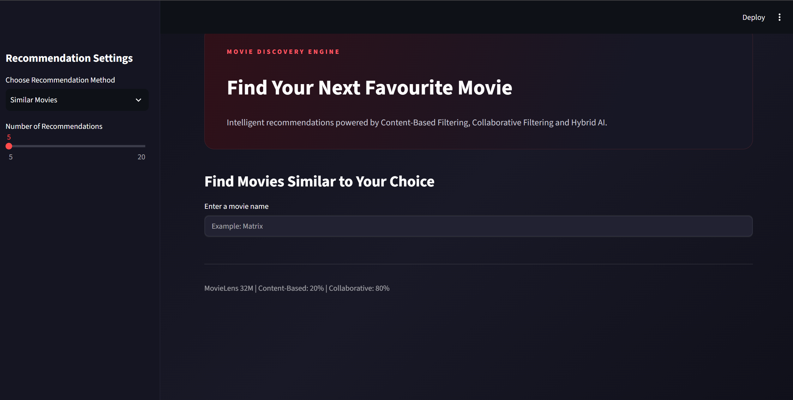
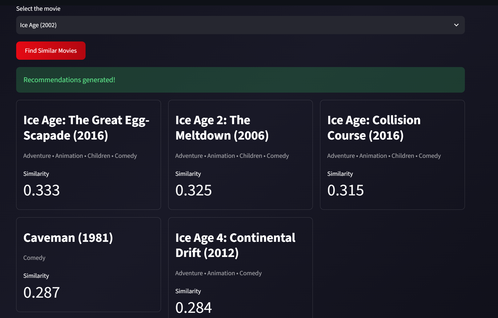
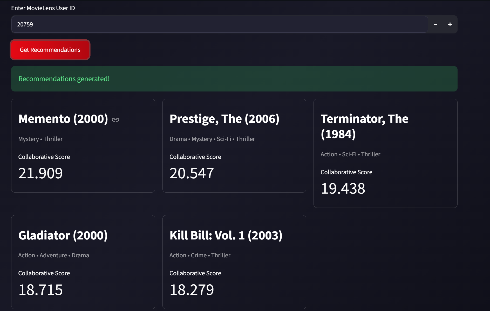
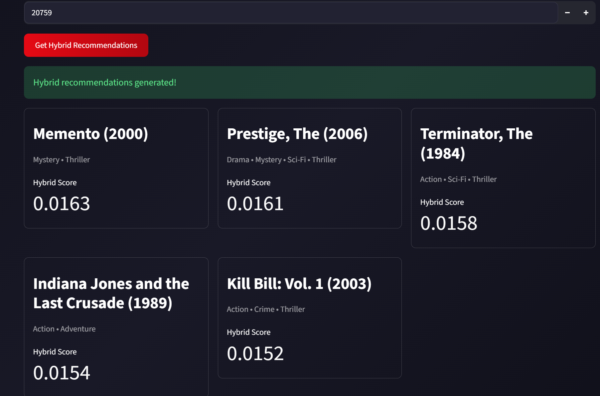
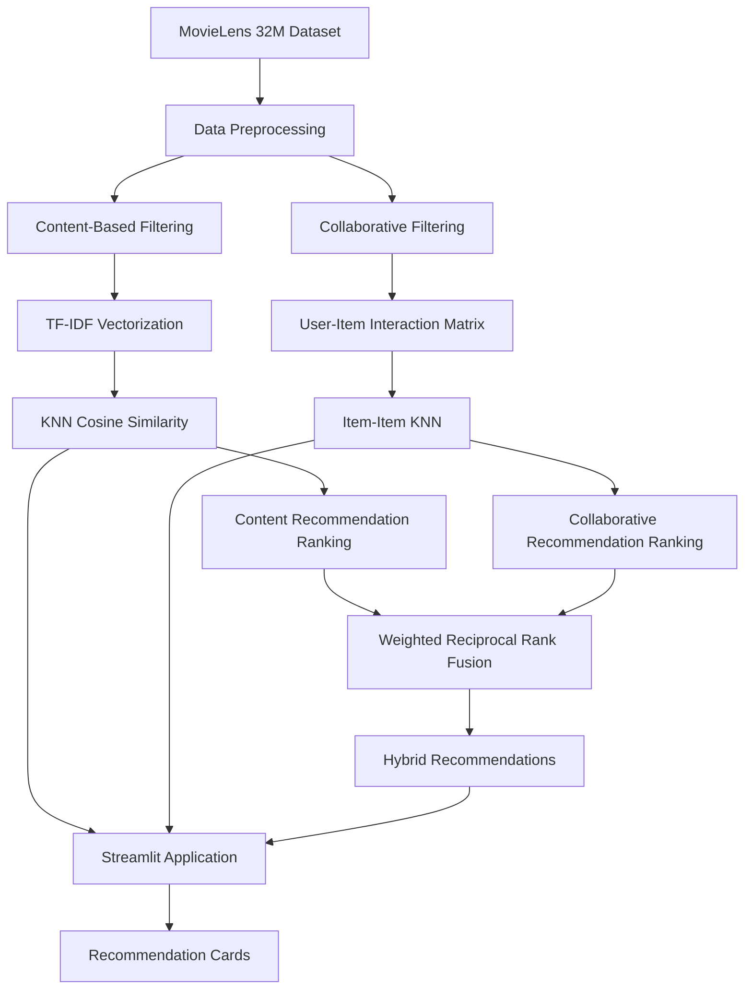

# 🎬 Hybrid Movie Recommendation System

A hybrid movie recommendation system built using **Python, Scikit-learn, Pandas, SciPy and Streamlit**, using the [MovieLens 32M dataset](https://grouplens.org/datasets/movielens/32m/).

The system combines Content-Based Filtering and Collaborative Filtering through **Weighted Reciprocal Rank Fusion (RRF)** to generate personalized movie recommendations.

It provides an interactive Streamlit application where users can discover similar movies, receive recommendations using a MovieLens User ID, and explore hybrid recommendations.

**GitHub Repository:** [Hybrid Movie Recommendation System](https://github.com/Habeeb932/Hybrid-movie-recommendation-system)

**Model Artifacts:** [Hugging Face Repository](https://huggingface.co/Dragon39758/hybrid-movie-recommendation-artifacts)

---

# 1. Installation and Setup

Follow these steps to run the project locally.

## 1.1 Clone the Repository

```bash
git clone https://github.com/Habeeb932/Hybrid-movie-recommendation-system.git
```

Navigate to the project directory:

```bash
cd Hybrid-movie-recommendation-system
```

## 1.2 Create a Virtual Environment

```bash
python -m venv venv
```

Activate the environment.

**Windows:**

```bash
venv\Scripts\activate
```

**Linux / macOS:**

```bash
source venv/bin/activate
```

## 1.3 Install Dependencies

```bash
pip install -r requirements.txt
```

## 1.4 Download Model Artifacts

The trained model artifacts are hosted separately on Hugging Face to avoid storing large binary files in GitHub.

Download the following files from the [Hugging Face repository](https://huggingface.co/Dragon39758/hybrid-movie-recommendation-artifacts/tree/main):

- `content_artifacts.joblib`
- `collaborative_artifacts.joblib`
- `train_ratings.parquet`

Create an `artifacts/` directory in the project root and place all three downloaded files inside it.

Expected structure:

```text
artifacts/
├── content_artifacts.joblib
├── collaborative_artifacts.joblib
└── train_ratings.parquet
```

## 1.5 Download the Dataset

Download the MovieLens 32M dataset from:

https://grouplens.org/datasets/movielens/32m/

Extract it into:

```text
data/ml-32m/
```

The dataset is used for the notebook experiments and model development.

## 1.6 Run the Application

Start the Streamlit application:

```bash
streamlit run app.py
```

The application will open in your default browser.

---

# 2. Application Screenshots

The application provides three recommendation modes through an interactive Streamlit interface.

## 2.1 Application Dashboard

The dashboard provides access to the recommendation methods and allows users to configure the number of recommendations.



## 2.2 Content-Based Recommendations

Content-Based Filtering recommends movies similar to a selected movie using genre and tag information.

The application displays recommended movie titles, genres and similarity scores.



## 2.3 Collaborative Recommendations

Collaborative Filtering generates personalized recommendations using a MovieLens User ID.

The system uses historical rating interactions and item-item similarity to identify relevant movies.



## 2.4 Hybrid Recommendations

The Hybrid Recommendation System combines Content-Based and Collaborative recommendations using Weighted Reciprocal Rank Fusion.

The final recommendations are displayed with their hybrid ranking scores.



---

# 3. Project Overview

Traditional recommendation systems generally rely on one of two approaches:

- Content-Based Filtering recommends items based on their characteristics.
- Collaborative Filtering identifies patterns from user-item interactions.

Both approaches have individual limitations. This project combines them into a hybrid recommendation framework to leverage their complementary strengths.

## Key Features

- Content-Based Movie Recommendations
- Collaborative Movie Recommendations
- Hybrid Recommendations using Weighted RRF
- TF-IDF Feature Extraction
- K-Nearest Neighbors with Cosine Similarity
- Sparse User-Item Interaction Matrix
- Interactive Streamlit Dashboard
- Recommendation Cards with Scores and Movie Genres

---

# 4. System Architecture

The system follows a modular architecture consisting of data preprocessing, recommendation model development, hybrid ranking and application presentation.



---

# 5. Dataset Description

This project uses the **MovieLens 32M dataset**, provided by GroupLens Research.

Dataset: https://grouplens.org/datasets/movielens/32m/

The dataset contains approximately:

- 32 million ratings
- 87,585 movies
- 2 million user-contributed tags

### Dataset Files

| File | Description |
|---|---|
| `movies.csv` | Movie IDs, titles and genres |
| `ratings.csv` | User ratings for movies |
| `tags.csv` | User-contributed movie tags |
| `links.csv` | External movie identifiers |

### Data Preprocessing

The preprocessing stage includes:

- Loading the MovieLens dataset.
- Cleaning and processing movie tags.
- Handling missing movie metadata.
- Combining genre and tag information.
- Preparing movie features for TF-IDF vectorization.
- Constructing sparse user-item interaction matrices.

---

# 6. Recommendation Methodology

## 6.1 Content-Based Filtering

Content-Based Filtering recommends movies based on similarities in their characteristics.

### Feature Engineering

Movie information is represented using:

- Genres
- User-contributed tags

The textual features are transformed into numerical representations using **TF-IDF (Term Frequency-Inverse Document Frequency)**.

### Similarity Calculation

The model uses:

- TF-IDF Vectorization to represent movie features.
- Cosine Similarity to measure similarity between movie vectors.
- K-Nearest Neighbors to retrieve similar movies.

The system returns movies ranked according to their similarity scores.

## 6.2 Collaborative Filtering

Collaborative Filtering generates recommendations using historical user-item rating interactions.

### Implementation

- Constructs a sparse user-item interaction matrix.
- Converts the matrix into an item-user representation.
- Uses K-Nearest Neighbors with cosine distance to identify similar items.
- Aggregates similarity scores using the ratings provided by a user.
- Excludes movies already rated by the user.

This approach identifies movies that may be relevant based on patterns in user preferences.

## 6.3 Hybrid Recommendation System

The hybrid approach combines Content-Based and Collaborative recommendation rankings using **Weighted Reciprocal Rank Fusion (RRF)**.

Instead of directly combining scores produced by different recommendation models, RRF combines their rankings.

### Weighted RRF Formula

\[
RRF(d)=
\frac{w_c}{k+rank_c(d)}
+
\frac{w_{cf}}{k+rank_{cf}(d)}
\]

Where:

- \(d\) represents a recommended movie.
- \(w_c\) is the content-based weight.
- \(w_{cf}\) is the collaborative weight.
- \(rank_c(d)\) is the content-based rank.
- \(rank_{cf}(d)\) is the collaborative rank.
- \(k\) is the RRF constant.

### Final Model Configuration

| Component | Weight |
|---|---:|
| Content-Based Filtering | 20% |
| Collaborative Filtering | 80% |

The final configuration prioritizes collaborative recommendations while retaining content-based information in the ranking process.

---

# 7. Model Evaluation and Experimental Results

The recommendation models were evaluated using ranking-based metrics.

## 7.1 Evaluation Metrics

| Metric | Description |
|---|---|
| Precision@10 | Fraction of recommended movies that are relevant |
| Recall@10 | Fraction of relevant movies successfully recommended |
| NDCG@10 | Measures ranking quality while considering the position of relevant recommendations |

## 7.2 Experimental Results

The following results were obtained from the model evaluation experiments.

| Recommendation Model | Precision@10 | Recall@10 | NDCG@10 |
|---|---:|---:|---:|
| Popularity-Based Baseline | 0.056 | 0.023596 | 0.063029 |
| Content-Based Filtering | 0.045 | 0.021589 | 0.050785 |
| Collaborative Filtering | 0.104 | 0.035991 | 0.125567 |
| Hybrid (20:80) | **0.111** | — | **0.133183** |

*Note: The hybrid Recall@10 value is not included because the final value has not yet been confirmed.*

## 7.3 Weighted RRF Experiments

Different combinations of content-based and collaborative weights were experimented with to understand their effect on recommendation quality.

The 20:80 configuration was selected for the final implementation because it achieved the strongest reported Precision@10 and NDCG@10 among the tested configurations.

The 40:60 configuration achieved the strongest reported Recall@10.

## 7.4 Evaluation Methodology

The evaluation process included:

- A temporal train-test split.
- Warm-start user evaluation.
- A sample of 100 users.
- Ranking-based evaluation using Precision@10, Recall@10 and NDCG@10.

The reported results should be interpreted in the context of the evaluation sample and experimental setup.

---

# 8. Technologies Used

| Technology | Purpose |
|---|---|
| Python | Core programming language |
| Pandas | Data manipulation |
| NumPy | Numerical operations |
| SciPy | Sparse matrix operations |
| Scikit-learn | TF-IDF and KNN models |
| Streamlit | Interactive web application |
| Joblib | Model artifact serialization |
| PyArrow | Parquet data handling |
| Jupyter Notebook | Model development and experimentation |

---

# 9. Project Structure

```text
Hybrid-movie-recommendation-system/
│
├── app.py
├── PYTHONpro.ipynb
├── requirements.txt
├── README.md
├── .gitignore
│
├── src/
│   ├── preprocessing.py
│   ├── content_based.py
│   ├── collaborative.py
│   ├── hybrid.py
│   └── movie_cards.py
│
├── docs/
│   └── images/
│       ├── app-home.png
│       ├── content-based.png
│       ├── collaborative.png
│       └── hybrid.png
│
├── data/
│   └── ml-32m/
│
└── artifacts/
    ├── content_artifacts.joblib
    ├── collaborative_artifacts.joblib
    └── train_ratings.parquet
```

**Note:** The dataset and trained model artifacts are excluded from GitHub because of their size. They are hosted separately.

---

# 10. Limitations

- The reported evaluation uses a sample of 100 users, so the results may not represent the entire user population.
- Warm-start evaluation does not fully address cold-start users and movies.
- Collaborative Filtering relies on historical user-item interactions.
- Brute-force KNN can be computationally expensive for large datasets.
- Recommendation quality depends on the available rating and metadata information.

---

# 11. Future Improvements

Potential future improvements include:

- Incorporating movie posters and richer movie metadata.
- Exploring additional recommendation algorithms.
- Improving recommendation diversity and coverage.
- Optimizing nearest-neighbor search for scalability.
- Expanding evaluation to a larger set of users.
- Exploring additional hybrid weighting strategies.
- Deploying the application for public access.

---

# 12. References

1. GroupLens Research — MovieLens Datasets: https://grouplens.org/datasets/movielens/
2. Scikit-learn Documentation: https://scikit-learn.org/
3. Streamlit Documentation: https://docs.streamlit.io/
4. Cormack, Clarke and Buettcher (2009). *Reciprocal Rank Fusion Outperforms Condorcet and Individual Rank Learning Methods.*

---

# 👨‍💻 Author

**Habeeb Nadendla**

- GitHub: https://github.com/Habeeb932
- Project Repository: https://github.com/Habeeb932/Hybrid-movie-recommendation-system
- Model Artifacts: https://huggingface.co/Dragon39758/hybrid-movie-recommendation-artifacts

---

⭐ If you find this project interesting, consider giving the repository a star!
